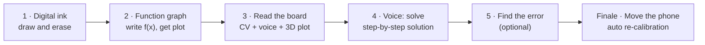

# 01 · Project Overview

_Working title: Projected Interactive Whiteboard. Last updated: 2026-10-27._

## 1. One-liner

Any whiteboard becomes an interactive, AI-assisted teaching surface with a projector, a phone camera and a laptop. You write with your finger or a normal marker, and you talk to the board.

## 2. Event context

| Item | Detail |
|------|--------|
| Event | HackCC, November 2026 (California community college students only) |
| Theme we target | Education |
| Official schedule | Day 1 10:00 to day 2 21:00 (about 35 hours, including check-in, opening ceremony, demos, judging and awards) |
| Real hacking time | Not confirmed. We plan for about 20 hours of effective development |
| Team | 4 people, all building this project together |
| Sponsor tool we will use | None required. ElevenLabs is no longer a sponsor, so voice uses the browser's built-in speech recognition |

## 3. What changed from the earlier idea

The first version used IR-detection hardware and an IR pen. This version is **pure computer vision**:

- No IR pen and no IR hardware. A finger is the pen.
- Touch is detected from the finger's **shadow** on the board, not from a depth sensor.
- Normal whiteboard markers and printed paper still work, because the camera can read physical content (see step 3 of the demo).

The earlier idea's features (voice agent, math and physics visualisation) carry over. The physics visualisations (kinematics, forces, circuits, waves) and CS code visualisation are **not** in the demo scope; they are future ideas.

## 4. How it works (high level)

```
projector  →  hand  →  whiteboard          (the central line)
                ↑                ↑
   person (right side)     phone camera (left, oblique)
```

See the [top view](assets/setup-top-view.svg) and [side view](assets/setup-side-view.svg).

Three layers:

1. **Physical layer.** The board, marker writing, printed problem sheets.
2. **Digital layer.** What the projector draws: ink strokes, buttons, panels, function plots, 3D plots, text.
3. **AI layer.** Voice input, handwriting recognition, solving, plotting, error finding.

The camera ties them together: it sees the hand and the shadow (interaction), and it can read the physical layer on request.

## 5. Demo script

Everything is set up and calibrated before judges arrive. Steps run in order, from easiest to most impressive.



### Step 1: Digital whiteboard

- One finger drawn on the board leaves a stroke that follows the finger, like an electronic whiteboard.
- In the air (not touching the board), do a **thumb and index finger double tap** to switch between pen and eraser: pen → eraser, eraser → pen. With no tool selected, the first double tap picks the **eraser**. Touch the board again to erase the strokes just written.
- Need more room? Hold an **open hand** up, **close it into a fist**, and move the fist: the board moves with it. **Open the hand** to stop.
- Under the hood: shadow touch detection, homography, stroke smoothing, gesture recognition.

All agreed gestures are listed in the [technical design, section 5](02-technical-design.md#5-gestures).

### Step 2: Function graph

- Write a function by hand on the board. Open a panel (an air gesture, or tapping a button on the board; the button is the safer choice), select it and tap **Plot**.
- The system recognises the handwritten function and draws its graph next to it.
- Under the hood: strokes rendered to an image, a multimodal model returns LaTeX, a plotting library draws the graph.

### Step 3: Read the physical board, then 3D

- Stick a printed system of equations on the board, or write it with a real marker. The system does not know about it electronically; it must read it with the camera.
- Trigger voice input and say something like: "Draw a 3D coordinate system for this system of equations." A 3D plot appears in a suitable empty place.
- Then manipulate it:
  - **pinch and hold** (thumb and index) and move the hand: rotate the 3D model
  - **pinch with both hands**, then stretch them apart to zoom in or bring them together to zoom out
  - **reset**: hold **both hands open**, palms to the camera, still for **2 seconds** (a countdown ring shows on the board). The view goes back to the start: board position, zoom and 3D angle. Reset never changes the writing; use Undo to bring back erased ink.
- Under the hood: the projector briefly flashes pure white (or black) over the region so the camera sees the physical writing cleanly, a multimodal model reads it, the layout engine places the plot where nothing is covered.

### Step 4: Voice: solve

- Trigger voice input and say "solve the current equations." The AI computes and shows the solution steps beside the problem.

### Step 5 (optional): Find the mistake

- A printed problem with a wrong worked solution (simulating a teacher's slip) is stuck on the board, or an image is dragged into the digital board.
- Ask the AI which step is wrong. It explains the error in text, optionally circles the wrong step, and continues from the mistake to the correct answer.
- This is the strongest educational moment. Do it if there is any time.

### Finale: Re-calibration

- Near the end of the demo, move the phone slightly: still front-left, only a small change of angle. The system detects the move, briefly projects an ArUco calibration pattern, recomputes the mapping, and the board works again immediately.

## 6. Pitch storyline

Do not list five features. Tell one story that runs through steps 1, 2, 4, 5:

> A teacher writes a problem on the board → the board plots it → the board solves it → the board notices the teacher's own mistake.

Then show the physical-to-digital step (3) as the "it reads real marker writing" proof, and the re-calibration as the robustness proof. The pitch is improvised from this storyline; there is time to practise after the Devpost deadline and before judging.

## 7. Scope tiers

| Tier | Contents | Reason |
|------|----------|--------|
| Must have | Steps 1, 2, 4 | A complete story: write, plot, solve |
| Second priority | Step 5 (find the mistake) | Mostly an AI task, low cost, highest educational value |
| Last | Step 3 in full (physical reading plus gestured 3D) | Heaviest block: CV reading, 3D rendering, multi-finger input |
| Stretch | Automatic re-calibration finale | Comes almost for free if calibration is fully automatic from the start |

Fallbacks for step 3 if time runs out: 3D from an on-screen equation plus voice only; on-board rotate, zoom and reset buttons instead of the two-hand zoom.

## 8. Non-goals

- No IR pens or special hardware.
- No support for a moving or hand-held board (the board must be fixed).
- No physics or CS-code visualisations in the demo.
- No multi-user or multi-board support.

## 9. Glossary

| Term | Meaning |
|------|---------|
| Homography | A 3×3 matrix mapping points on one plane (the board as seen by the camera) to another plane (projector pixels) |
| ArUco marker | A printed or projected black-and-white square with an ID, easy to detect with OpenCV |
| Rectified plane | The board plane after applying the homography; all geometry is done here |
| Shadow tip | The point where the fingertip's shadow ends on the board |
| Static markers | Physical ArUco stickers around the board, used to notice that something moved |
| Event bus | The WebSocket channel the four modules use to exchange JSON events |
