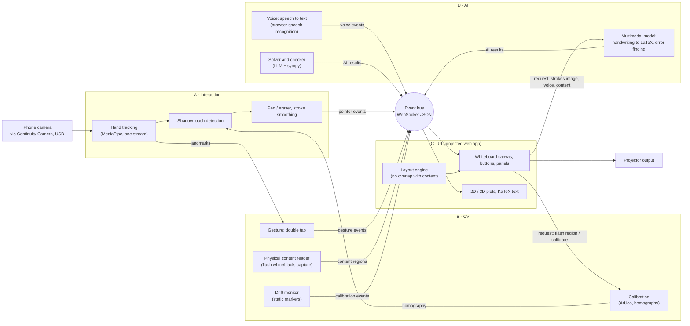

# 02 · Technical Design

_Last updated: 2026-10-27. Status: design before implementation. Anything marked **to verify** must be tested before we rely on it._

## 1. Design principles

1. **One coordinate space.** Everything (touch points, content regions, AI output positions) is expressed in **projector pixel coordinates**. "Where" always means the same thing for all four modules.
2. **One hand-tracking stream.** Run hand tracking once and publish the landmarks; every module subscribes. Do not run MediaPipe twice.
3. **Do geometry in the rectified plane.** Map camera pixels to the board plane first, then compare points there. Thresholds are then in board units and survive a change of camera angle.
4. **Calibrate automatically, always.** The re-calibration finale, the venue move and an accidental bump are the same problem.
5. **Degrade loudly.** If calibration is bad, the UI says so. It never silently uses a bad result.

## 2. System architecture



Dependencies that matter:

- A needs a calibration (homography) from B. Until B delivers, A uses a **manual four-corner click** homography.
- C needs B's content regions to avoid covering physical writing.
- B's flash capture needs C to render pure white or black on request.
- D's results need positions from B (for circling a wrong step) and layout from C.

## 3. Calibration (camera to projector)

**Goal:** a homography H that maps a point in the camera image, lying on the board plane, to the matching point in projector pixels.

Procedure:

1. Project a grid of ArUco markers (3×3 or more; larger markers than you think, so they survive an oblique angle).
2. Wait a few frames for the projection to settle, then grab about 10 to 20 frames.
3. Detect markers in each frame, take the **median** of each corner (or RANSAC) to reject noise.
4. Compute H with all detected corners (`cv2.findHomography`, RANSAC).
5. **Verify:** compute the reprojection error. Also project a few check points and compare. If the error or the number of detected markers is below the bar, retry automatically and say so on screen.
6. Save the result (timestamp, H, error, exposure settings) to a file, so a good calibration can be restored.

Notes:

- Use the same camera exposure for calibration and for later use. A different exposure changes brightness thresholds.
- Use maximum projector brightness and high-contrast black and white markers with white borders. Briefly hide other UI during calibration.
- A tilted board is just another plane; H absorbs the tilt and the keystone distortion. The UI is pre-warped with H⁻¹ so that content looks undistorted on the board.
- **Turn off the projector's own keystone correction** (including auto keystone). We do the correction in software; a second one on top loses resolution, and if it changes during the session the calibration becomes silently wrong. Calibrate only after the projector is placed and its settings are final.

## 4. Touch detection with the shadow

See the diagram: [shadow-touch-geometry.svg](assets/shadow-touch-geometry.svg).

**Principle.** The projector is close to a point light source. The finger casts a shadow on the board. The farther the fingertip is from the board, the farther the shadow tip is from the fingertip, as seen by the camera. At contact, they meet. This needs no depth camera. Monocular depth from hand landmarks (for example the z value from MediaPipe) is not reliable enough for touch (**to verify** on our hardware).

**Algorithm (per frame):**

1. Hand landmarks give the index fingertip position in camera pixels.
2. Find the shadow tip near the fingertip: the dark region on the board next to the hand, converted to a mask by comparing the camera image against the image the projector is *expected* to be showing (difference image), or by simple thresholding when the background is bright.
3. Map **both** points to the rectified board plane with H. The shadow tip lies on the board, so its mapping is exact. A hovering fingertip is offset in proportion to its height above the board.
4. Compute the distance `d` between the two points in board-plane units.
5. `touching = d < threshold`, with hysteresis and a temporal filter (for example N consecutive frames) to stop flicker and broken lines.
6. Only when `touching` is true, publish the mapped position as the pen position. Smooth it (One Euro filter is a good default).

**Making the shadow visible:**

- A dark UI hides the shadow. Use a light (white) canvas, or add a small white spot of light that follows the hand, or use the expected-versus-actual difference image.
- Environment light reduces shadow contrast. The projector must be bright; a blackout cloth around the board helps.
- Projector position changes the shadow. We have no tripod, so the projector is either on the table aimed up (low, grazing light: longer and fainter shadow, more arm occlusion) or on a raised platform (see [hardware doc](04-hardware-setup-and-risks.md#2-physical-layout)). Test both; thresholds depend on the choice.

**Other known issues (to test early):**

- The hand is lit by the projected content; this may confuse hand tracking.
- Oblique camera: the hand can occlude its own fingertip.
- Several shadows appear if the presenter's body is in the beam. Keep the beam clear.
- Camera frame rate and latency decide how responsive writing feels. Measure end-to-end (finger moves → stroke appears).

**Fallbacks if the shadow method is not reliable (decide before the event):**

1. Dwell: a fingertip held still near the board for a short time counts as a touch.
2. A small spot of white light near the fingertip to strengthen the shadow.
3. Tap buttons instead of free gestures wherever possible.

## 5. Gestures

| Gesture | Used for | Rule |
|---------|----------|------|
Agreed with the team (more may be added later):

| Gesture | Used for | Rule |
|---------|----------|------|
| Index finger touching the board | Draw (or erase in eraser mode) | Touch detection from section 4. Never draws while thumb and index are pinched |
| Thumb and index **double tap** in the air | Toggle pen and eraser | pen → eraser, eraser → pen; with no tool selected the first double tap picks the **eraser**. Two short pinches close together, only while **hovering** |
| Open hand, then **fist**, then move | Move (pan) the board | The board follows the fist; opening the hand stops it |
| Thumb and index **pinch and hold**, then move | Rotate a 3D model | A held pinch (longer than a tap), so it is never mistaken for the double tap |
| **Pinch with both hands**, change the distance | Zoom in (apart) and out (together) | Scale = current distance / starting distance, centred between the two pinches. Needs two tracked hands |
| **Both hands open**, palms to the camera, held still **2 s** | Reset the view: board position, zoom and 3D angle back to the start | A countdown ring shows on the board; lowering the hands cancels it. **View only**: never restores erased ink or removes writing (that is Undo). A Reset button does the same |

Telling the gestures apart:

- **Tap or hold:** a double tap is two short pinches; a pinch held longer starts rotating. Decide by how long the pinch lasts.
- **Writing or pinching:** the index finger only draws when it touches the board with the thumb apart from it.
- **Two hands:** hand tracking runs with two hands so the two-hand zoom works.
- **Fallbacks** if a gesture is unreliable on our setup: on-board buttons for the same action (pen/eraser, rotate, zoom, reset).

Opening the panel in step 2 should be a **button on the board**, because a button tap reuses touch detection.

## 6. Reading physical content

Problem: the camera sees physical writing and the projected image mixed together.

Procedure (triggered by voice, a button or a selected region, **not** every frame):

1. Lock camera exposure and white balance (see [hardware doc](04-hardware-setup-and-risks.md)).
2. Ask the UI to show **pure white** (or black) in the chosen region.
3. Wait a few frames for the display and camera to settle, then capture.
4. Rectify the region with H and send it to the multimodal model.
5. Publish the result and the **content regions** (bounding boxes in projector pixels) on the event bus, so C can avoid them.

## 7. Layout: do not cover content

C keeps a list of occupied rectangles:

- digital ink (bounding boxes of strokes)
- physical content regions from B (printed sheets, marker writing)
- existing panels, plots and text

For each new output (plot, solution text, circle), C picks a free rectangle near the source: generate candidate rectangles, reject any that overlap an occupied one, choose the closest or largest. Physical regions are refreshed only when B re-reads the board.

## 8. AI layer

| Task | Approach |
|------|----------|
| Handwritten function to LaTeX | Render strokes to an image; send to a multimodal model; ask for LaTeX. Better than classical handwriting OCR |
| Printed or marker-written equations | Rectified camera crop (from section 6) to the same model |
| Plot a 2D function | Parse LaTeX, plot with a JS plotting library (Plotly, function-plot or mathjs; team's choice) |
| 3D plot of equations | three.js (or Plotly 3D) with orbit, zoom, pan controls |
| Voice | Speech to text for commands with the browser's built-in speech recognition (Web Speech API: no key or server, works in Chrome, Edge and Safari, needs the internet in Chrome). Text to speech for replies is still to be chosen (the browser's speech synthesis is the free option) |
| Spoken question | The transcribed question, plus the board image when there is writing on screen, goes to the model. It answers as short text and formula blocks, shown on the board as a card. Sentences that are not board commands are treated as questions |
| Solve | LLM produces steps, one per line; render with KaTeX. Verify the final answer with `sympy` where possible |
| Find the wrong step | Model returns the step number, a short explanation, a corrected continuation and a bounding box of the wrong step; B converts the box to projector coordinates; C draws the circle |

Prompts should ask for structured JSON so that C can render without parsing prose.

## 9. Event bus (draft v0: agree on this in the first hour)

Transport: WebSocket, JSON messages. All positions in projector pixels. Build a **fake event emitter** first, so C and D can develop before A and B are ready.

```json
// A: pointer (one per finger; id lets us support multi-touch later)
{ "type": "pointer", "id": 0, "x": 812.4, "y": 440.1, "touching": true, "t": 1767000000.123 }

// B: gesture
{ "type": "gesture", "name": "double_tap", "t": 1767000000.456 }

// B: content regions on the physical board
{ "type": "content_regions", "regions": [
  { "id": "r1", "kind": "handwriting", "bbox": [120, 80, 400, 160] },
  { "id": "r2", "kind": "print",       "bbox": [700, 60, 300, 380] }
] }

// B: calibration status
{ "type": "calibration", "status": "ok", "reproj_error_px": 1.2, "markers_found": 9 }

// B / C: request to flash a region
{ "type": "flash_request", "color": "white", "bbox": [100, 60, 500, 300] }

// D: AI result (kind: latex | plot | steps | error_check | voice_state)
{ "type": "ai_result", "kind": "steps", "steps": ["x + y = 5", "x = 5 - y"], "anchor_bbox": [700, 60, 300, 380] }
{ "type": "ai_result", "kind": "error_check", "wrong_step": 3, "explanation": "…", "bbox": [150, 300, 420, 60] }
```

## 10. Automatic re-calibration

- Stick a few **static** ArUco markers around the board edge or on stable surroundings, outside the projected area.
- Detect them continuously. If they shift beyond a threshold in the image, the camera (or board) moved: pause interaction, project the calibration grid, recompute H, verify, resume.
- This gives the finale (move the phone slightly) and also recovers from an accidental bump.
- Limit: if the **board** moves relative to the projector, tracking static markers only fixes what the camera sees. Projected content and physical content would be misaligned. This is why the board must be fixed (see [hardware doc](04-hardware-setup-and-risks.md)).

## 11. Suggested stack (the team decides)

| Area | Suggestion |
|------|------------|
| Hand tracking | MediaPipe Hands |
| CV, ArUco, homography | OpenCV (`cv2.aruco`, `findHomography`) |
| Camera input | iPhone via Continuity Camera on the MacBook; wired is preferred (to verify) |
| Backend and bus | Python with FastAPI/WebSocket, or Node; one process publishes events |
| Frontend | Web app on the projector display: canvas for ink, three.js, Plotly or mathjs, KaTeX |
| AI | A multimodal model API for vision and solving, `sympy` for checking, the browser's speech recognition for voice |

## 12. Open technical questions

- [ ] Does shadow-based touch detection work with our projector, board and room light? (Test first, in the simplest "draw a line" version.)
- [ ] Is Continuity Camera exposure stable enough when the projector flashes white? If not, use an iOS capture app with locked exposure.
- [ ] End-to-end latency from finger to stroke?
- [ ] Does MediaPipe track a hand lit by projected content?
- [ ] Are the double tap, fist, pinch-and-hold, two-hand pinch and two-palm reset reliable at our camera angle?
