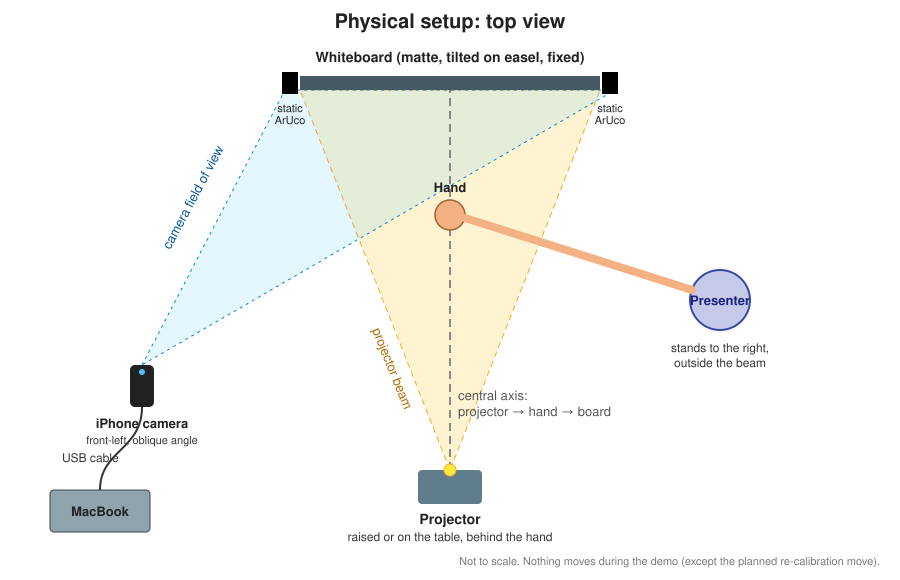
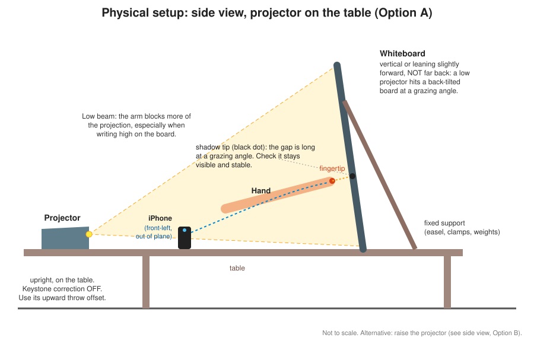
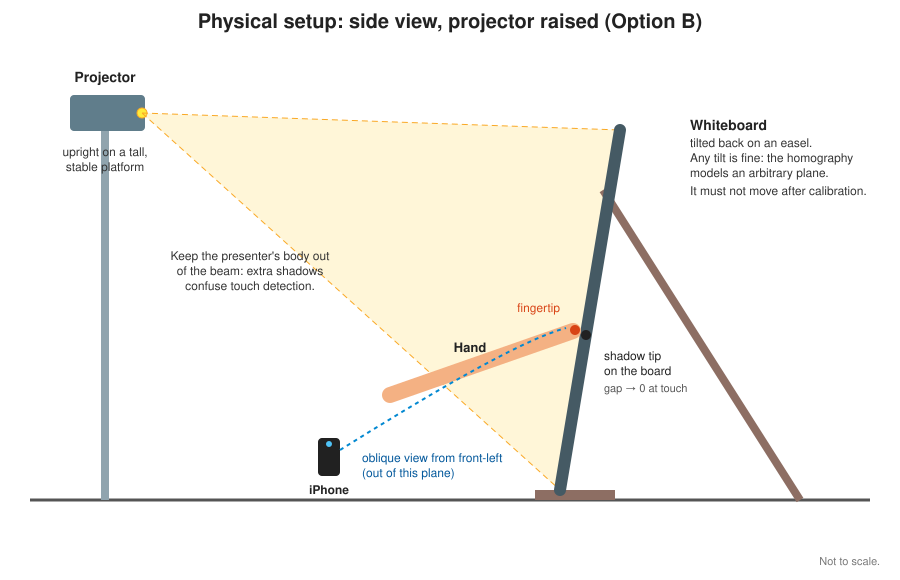
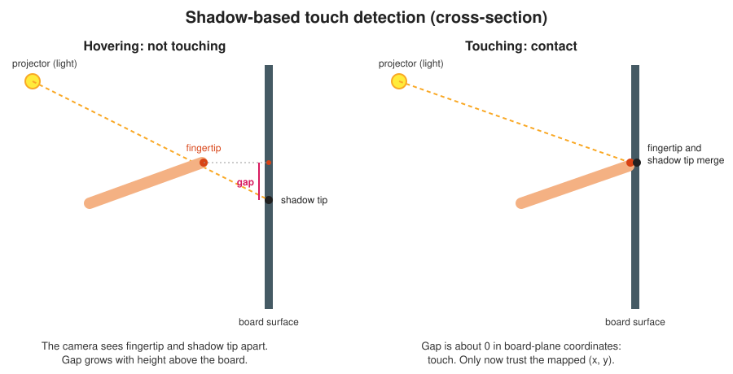

# 04 · Hardware, Physical Setup and Risks

_Last updated: 2026-10-27._

## 1. Equipment list

| Item | Status | Notes |
|------|--------|-------|
| Projector | Have | Model, brightness (lumens) and throw offset to be recorded. Bright is better: it fights room light and makes shadows clearer. We have no tripod or ceiling mount, so it sits on a table or on a raised platform (section 2) |
| Projector platform | To find or buy | Sturdy box or stack of books, a taller table or shelf, or a tripod stand with a flat tray. Projector stays **upright**; no inverted mounting needed. Add an anti-slip mat or tape |
| Whiteboard | To buy | **Matte** finish. Glossy boards give mirror-like hot spots |
| Backup board | To buy | White **matte foam core** (see section 4) plus self-adhesive dry-erase film if we want marker writing on it |
| Support for the board | To buy | Tabletop easel, large clamps, heavy weights, paper tape. The board must not move |
| iPhone | Have | Used as the camera through Continuity Camera on the MacBook |
| USB cable | Have/buy | Wired is preferred over wireless: more stable, lower latency |
| MacBook | Have | Runs the system |
| Blackout cloth | To buy | Large tablecloth or similar, to shade the board from room light |
| Static ArUco markers | Print | Stuck around the board for drift detection |
| Dry-erase markers, printed problem sheets, tape | Prepare | Demo step 3 and step 5 |
| Phone hotspot | Prepare | Backup internet for the AI and voice APIs |

## 2. Physical layout

Top view (SVG, open in a browser or any markdown viewer):

We have no tripod to hang the projector above the board, so there are two ways to place it. Both keep the projector **upright** (inverting is only needed for ceiling mounts).

**Option A: projector on the table, aimed up at the board.** This is the normal table-top use of a projector, and most projectors push the image above the lens centre line for it (check our model's throw offset).

**Option B: projector raised on a tall, stable platform** (stack of boxes, taller table or shelf, tripod stand with a tray), aimed down at the board.

How the shadow gives touch detection:

Which option to use is decided by a test, not by taste: try both with the real projector and pick the one with the clearer, more stable shadow, less glare, and less arm occlusion. Differences:

| | Option A: on the table | Option B: raised |
|---|---|---|
| Effort | None, works today | Needs a stable platform |
| Light angle on board | Low, grazing: longer, fainter shadow; image dimmer and less even | Closer to perpendicular: brighter and more even |
| Arm blocks the beam | More, especially writing high on the board | Less |
| Best board tilt | Vertical or slightly forward | Any tilt, including leaning back |
| Risk | Shadow too faint or too long | Platform wobbles |

Layout rules:

- Central line: **projector → hand → board**.
- Presenter on the **right**; the iPhone camera on the **left / front-left**, looking at the board obliquely.
- The presenter's body must stay out of the beam, otherwise extra shadows confuse touch detection. In Option A the beam is low, so also keep sleeves, bags and the laptop out of it.
- **Turn off the projector's own keystone correction** (including any auto keystone). Our calibration pre-warps the image; a second correction on top lowers resolution and, if it changes while running, silently invalidates the calibration.
- The camera must see: the whole board, the hand, and the shadow.
- Static ArUco markers go outside the projected area, so the drift monitor can always see them.
- Fix everything (tape, weights, clamps). After calibration, nothing moves except the planned re-calibration finale.

## 3. The board must not be hand-held

Boards without a stand are tempting to hold. Do not. Hand tremor breaks three things:

1. **Calibration.** The homography describes the board plane. If the plane moves, projected points slide.
2. **Alignment.** The projector does not follow the board, so ink and AI output slide against the physical writing; circles around a wrong step land in the wrong place.
3. **Touch detection.** Distance to the projector changes, so the shadow gap changes and the threshold fails.

If there is truly no way to fix the board, a teammate steadies it at the sides and does not move it. Tracking static markers on the board helps the camera but cannot fix projector misalignment. Treat this as a last resort.

## 4. Board surface and backup options

Matte is required. Test the real projector on each candidate for hot spots and shadow contrast as soon as it arrives.

| Option | Verdict | Notes |
|--------|---------|-------|
| Matte whiteboard | Primary | Allows real marker writing and erasing |
| White matte **foam core** | Best backup | Cheap, flat, stiff. Marker ink may not erase from the paper face: add self-adhesive matte dry-erase film (check reviews for glare), or stick written paper on it |
| White cardstock or poster paper | Emergency only | Too thin to stand, curls, often glossy |
| Plain white matte wall | Good if available | Only if the venue allows it. Not guaranteed |
| Projection fabric or white cloth | Possible | Must be framed and stretched flat; any wobble breaks the plane assumption |
| PVC foam board | Uncertain | Stiff and flat; unsure how well markers erase. Test a sample before buying |

Recommendation: buy both a whiteboard and a foam board; test both with the real projector; bring both, use the better one.

## 5. Easel tilt

A tilted board is fine: calibration models any plane. Things to watch:

- The shadow gap depends on the projection angle. Test projector position and board tilt together. A moderate angle gives a clear, not-too-long shadow; near-perpendicular light hides the shadow behind the finger; very grazing light makes it long and faint.
- **Tilt direction depends on where the projector is.** With the projector raised (Option B), leaning the board back brings the light closer to perpendicular. With the projector on the table (Option A) it does the opposite: leaning back makes the light more grazing, so keep the board vertical or lean it slightly forward. Cheap easels lean back, so for Option A use clamps, a bracket or a prop behind the board instead.
- Tune touch thresholds **at the final placement**.
- Cheap easels wobble. Weigh the base or tape it to the table; check the crossbar does not block the projected area.
- Back the board with something rigid so it does not bow.
- Tilting the board may reduce glare into the camera (to verify).

## 6. Camera: iPhone via Continuity Camera

- Appears as a normal camera on the MacBook, convenient for OpenCV and browser capture.
- **Risk:** exposure and white balance. We need them locked so the flash-white / flash-black capture is stable. As far as I know, manual control through Continuity Camera is limited (**to verify**).
- If it is a problem: use an iOS capture app that locks exposure and streams to the laptop.
- Prefer USB. Measure end-to-end latency, because writing feel depends on it.

## 7. Lighting

- Plan: a bright projector, plus the blackout cloth if the room is bright.
- Check projector lumens against the room; a dim projector in a lit hall makes shadows faint.
- Avoid direct overhead light on the board.
- We cannot fully reproduce venue light at home, so bring shading and test on site.

## 8. Risk register

Likelihood and impact are team estimates, to be revisited after the first tests.

| # | Risk | Likelihood | Impact | Mitigation | Fallback |
|---|------|-----------|--------|------------|----------|
| 1 | Shadow touch detection unreliable | Medium | Very high | Test the minimal draw-a-line version before the event; light canvas; difference image | Dwell-to-touch; white spot near fingertip; button-first UI |
| 2 | Glare on glossy board | Medium | High | Buy matte; test with the real projector | Foam board backup |
| 3 | Camera exposure drifts on flash | Medium | High | Lock exposure; test | Capture app on iPhone |
| 4 | Board or setup moves | Medium | High | Easel, clamps, weights, tape; drift monitor | Re-calibrate |
| 5 | Venue light too bright | Medium | Medium | Bright projector; blackout cloth | Move to a darker corner |
| 6 | Gestures confused with each other or with writing (tap vs hold, pinch vs touch, two hands) | Medium | Medium | Test at the real angle; timing rules; never draw while pinched | On-board buttons for the same actions |
| 7 | Hand lit by projection confuses tracking | Medium | Medium | Test early; adjust UI brightness near hand | Dim the area around the hand |
| 8 | Network or API trouble | Medium | High | Phone hotspot; test latency on site | Pre-recorded video; cached example responses |
| 9 | Dev and demo venues differ | High | Medium | Automatic calibration; full checklist ([05](05-setup-checklist.md)) | Reserve 1 to 2 hours at the demo spot |
| 10 | Gesture unstable on stage | Medium | Medium | Rehearse; stable gesture design | Backup demo video |
| 11 | Table-mounted projector: grazing light makes the shadow faint or too long, and the arm blocks the beam | Medium | High | Test both options early; light canvas; keep the board vertical or leaning forward | Raise the projector (Option B) |
| 12 | Projector keystone correction changes the image after calibration | Low | High | Keystone and auto keystone OFF; lock the projector position | Re-calibrate |
| 13 | Raised platform wobbles or gets bumped | Medium | High | Sturdy base, anti-slip mat, tape; drift monitor | Re-calibrate; fall back to Option A |

## 9. Open questions

- [ ] Projector model, lumens, throw distance, throw offset (how far above the lens the image appears)?
- [ ] Option A (table) or Option B (raised)? Decide after the first side-by-side test.
- [ ] Board size that fits our projector throw and the demo table?
- [ ] Does the venue provide tables, walls, power and Wi-Fi at the demo spot?
- [ ] Which camera mount holds the iPhone steady at the front-left?
