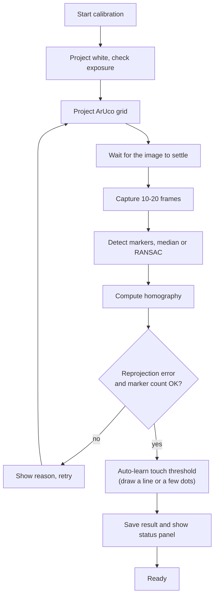

# 05 · Setup Checklist

_Last updated: 2026-10-27. Use before the event (tests), on arrival (setup) and before judging (final run)._

## 1. Before the event: minimum tests

As soon as the board arrives, set up projector, board and iPhone as planned and check:

- [ ] The camera clearly shows the whole board, the hand and the shadow.
- [ ] After the projector flashes white, the camera image brightness is stable.
- [ ] Shadows are clear under the lighting we expect.
- [ ] A minimal "draw a line with a finger" version works: no broken lines, few false touches.
- [ ] No glare hot spots from the projector on the board.
- [ ] Projector position: try **Option A (on the table)** and **Option B (raised)** and compare shadow clarity, brightness and how much the arm blocks the beam. Pick one and record it ([hardware doc](04-hardware-setup-and-risks.md#2-physical-layout)).
- [ ] End-to-end latency (finger moves → stroke appears) feels acceptable.

If these pass, the main hardware risk is largely gone.

**Teardown drill.** Pack everything up, set it up again from scratch, and time how long a full calibration takes. This exposes forgotten manual steps.

## 2. On-site setup (in order)

1. [ ] **Place** projector, board, iPhone. Fix them (tape, clamps, weights). Do not move them afterwards.
2. [ ] **Projector**: focus, cover the board, maximum brightness. **Keystone correction and auto keystone OFF.** Do not touch the projector's position or settings after this step.
3. [ ] **Camera**: sees the whole board, hand and shadow. Exposure and white balance locked (or verified stable on a white flash).
4. [ ] **Static markers** stuck around the board and detected.
5. [ ] **Calibrate** (one click, section 3). Check reprojection error and the cross check: project a cross, touch it, see the offset.
6. [ ] **Touch threshold**: draw lines in the centre and corners; check for gaps, false touches, missed touches.
7. [ ] **Gestures**: double tap, fist-move, pinch-and-hold rotate, two-hand zoom and reset each trigger reliably; writing never triggers any of them.
8. [ ] **Physical read test**: flash white/black and read printed or marker text correctly.
9. [ ] **Network**: measure latency; check API keys; hotspot ready as backup.
10. [ ] **Rehearse** the full demo twice: once normal, once with a disturbance (tap the table, block the beam briefly).

## 3. One-click calibration flow

Automated: exposure check, marker detection, homography, verification, threshold learning, status panel (error, threshold, frame rate, latency).
Manual: projector focus, physical placement, network, locking exposure (if the device does not allow it in software).

## 4. Making calibration robust

- Use many frames and the median, not a single frame.
- A grid of markers (3×3 or more), large and high contrast, with white margins.
- Wait for the projection to settle before capturing.
- Same exposure for calibration and use.
- Retry automatically on a bad result; never silently keep a bad one.
- Save each result (time, matrix, error) so a known good one can be restored.
- Keep monitoring the static markers during the demo.
- Time filtering on touch (N consecutive frames) against jitter.
- Clear on-screen message when calibration fails and why.

## 5. Before judging: final run

- [ ] Arrive at the demo spot with **1 to 2 hours** to spare.
- [ ] Full setup and calibration at the demo spot, not just at the hacking table.
- [ ] Two complete demo runs (one with a disturbance).
- [ ] Backup video recorded and ready on the laptop.
- [ ] Re-calibration finale rehearsed: move the phone slightly, same general position (front-left), only a small change of angle.
- [ ] Spare board, tape, cables, cloth, markers, printed sheets in reach.

## 6. Quick troubleshooting

| Symptom | Likely cause | First thing to try |
|---------|--------------|--------------------|
| Strokes appear offset from the finger | Calibration stale, board or projector moved, or keystone setting changed | Check keystone is off and nothing moved; re-calibrate |
| Broken lines while writing | Shadow weak, threshold too strict | Increase contrast (light canvas, white spot), loosen threshold, add temporal filter |
| Ink appears when finger hovers | Threshold too loose | Tighten threshold; re-learn it at the final position |
| Calibration keeps failing | Markers not detected | More brightness, larger markers, check exposure, reduce room light |
| Physical read returns garbage | Exposure unstable or region not flashed long enough | Lock exposure; wait more frames; check rectification |
| Double tap fires while writing | Gesture too permissive | Only accept it when hovering; stricter pinch threshold |
| Lag between finger and stroke | Camera latency or processing load | Use USB; lower resolution; check CPU |
| AI or voice not responding | Network | Switch to phone hotspot; use backup video |
